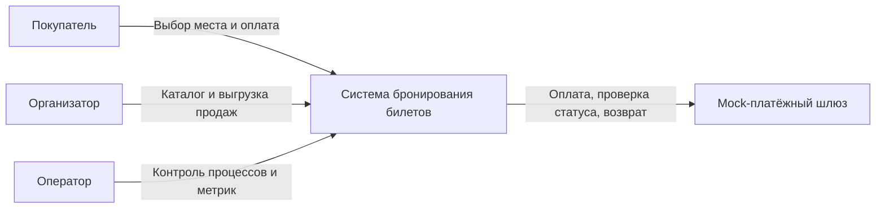
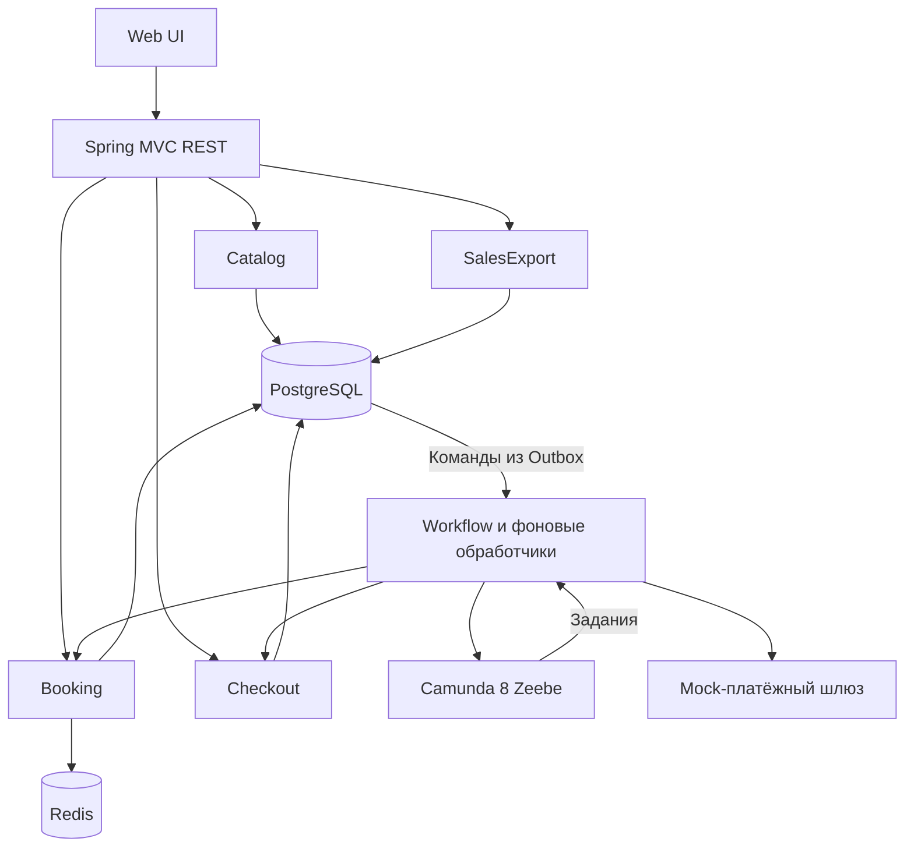
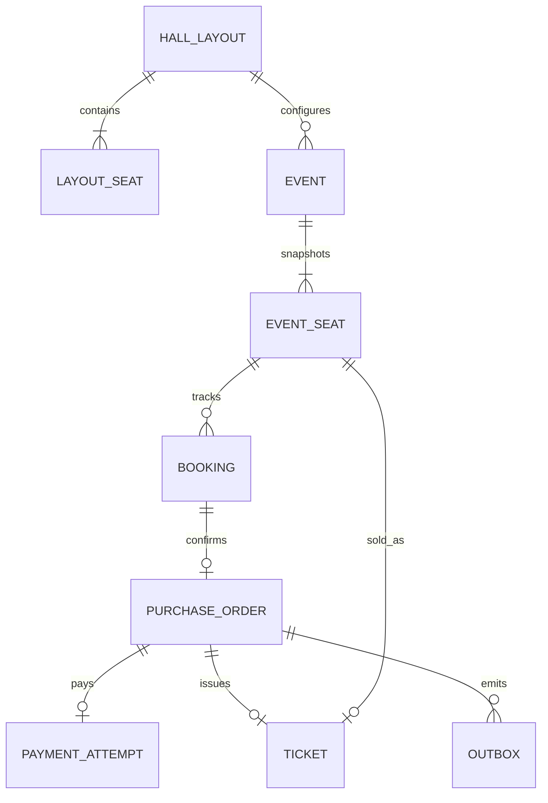
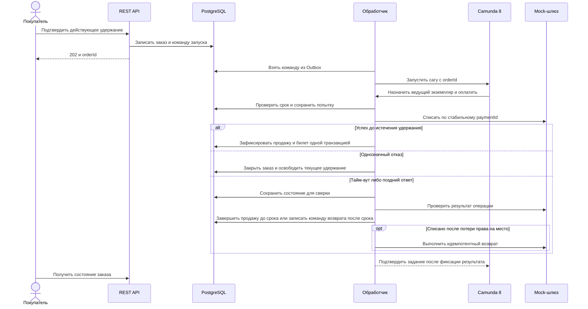
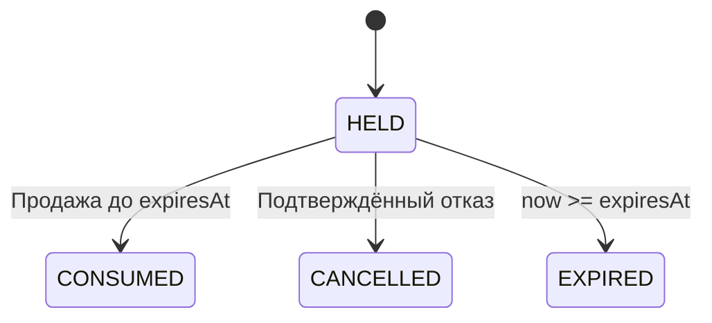
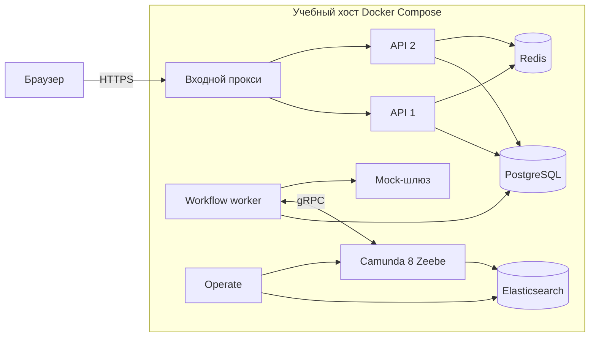

# Описание дизайна программного обеспечения

Для проекта «Система высоконагруженного бронирования билетов»

Версия 0.2  
Подготовил Сыман Владислав Алексеевич  
БГУИР, кафедра электронных вычислительных машин  
2026-11-19

## Оглавление

- [1. Введение](#1-introduction)
  - [1.1 Назначение документа](#11-document-purpose)
  - [1.2 Область применения](#12-subject-scope)
  - [1.3 Определения, акронимы и сокращения](#13-definitions-acronyms-and-abbreviations)
  - [1.4 Ссылки](#14-references)
  - [1.5 Обзор документа](#15-document-overview)
- [2. Обзор дизайна](#2-design-overview)
  - [2.1 Задачи стейкхолдеров](#21-stakeholder-concerns)
  - [2.2 Выбранные точки зрения](#22-selected-viewpoints)
- [3. Проектные представления](#3-design-views)
- [4. Решения](#4-decisions)
- [5. Приложения](#5-appendixes)

## История изменений

| Автор | Дата | Причина изменения | Версия |
|---|---|---|---|
| Сыман В. А. | 2026-11-19 | Исходная архитектура по SRS, минимальный каталог после первого раунда | 0.1 |
| Сыман В. А. | 2026-11-19 | Добавлены контракт и ограничения выгрузки CSV по CR-02 | 0.2 |

<a name="1-introduction"></a>

## 1. Введение

<a name="11-document-purpose"></a>

### 1.1 Назначение документа

SDD описывает проектирование веб-приложения для продажи билетов. Разработчики используют его для распределения ответственности и согласования интерфейсов, тестировщики — для вывода интеграционных сценариев, операторы — для определения сигналов о сбоях. Документ развивает базовый SRS и его дополнение с проверяемыми системными требованиями.

<a name="12-subject-scope"></a>

### 1.2 Область применения

Первый релиз включает каталог залов и мероприятий, схему мест, удержание одного места на 15 минут, защиту от двойной продажи, оплату через Mock-шлюз, выдачу билета и выгрузку CSV организатором. Предлагаемая архитектура рассчитана на несколько экземпляров серверного приложения. Состав выпуска ограничен одним местом на оформление, учебными платежами и выгрузкой до 10 000 билетов на мероприятие. Графический редактор зала относится к очереди развития.

<a name="13-definitions-acronyms-and-abbreviations"></a>

### 1.3 Определения, акронимы и сокращения

| Термин | Определение |
|---|---|
| ADR | Запись архитектурного решения с альтернативами и последствиями |
| API | Программный интерфейс |
| BPMN | Нотация моделирования бизнес-процессов |
| CSV | Текстовый формат табличных данных с разделителем |
| Outbox | Таблица команд, записываемых в одной транзакции с предметными данными для последующей отправки |
| Saga | Последовательность локальных операций и компенсирующих действий |
| SDD | Описание дизайна программного обеспечения |
| SRS | Спецификация требований к ПО |
| TTL | Время жизни удержания |
| p95 | Значение задержки, в которое укладываются 95% наблюдений |

<a name="14-references"></a>

### 1.4 Ссылки

| Источник | Владелец, версия или редакция | Роль |
|---|---|---|
| [Базовый SRS](../srs/srs-template.md) | Сыман В. А., редакция от 2026-10-10 | Исходные требования |
| [Дополнение к SRS](../srs/lab4-addendum.md) | Сыман В. А., 1.0 от 2026-11-19 | Уточнённые системные требования и состав первого релиза |
| [Шаблон SDD](sdd-template.md) | Шаблон репозитория курса | Нормативная структура документа |
| [Camunda 8 Job workers](https://unsupported.docs.camunda.io/8.5/docs/components/concepts/job-workers/) | Camunda, архив версии 8.5 | Справочная документация по заданиям и повторной доставке |
| [PostgreSQL Explicit Locking](https://www.postgresql.org/docs/16/explicit-locking.html) | PostgreSQL Global Development Group, версия 16 | Справочная документация по блокировке строк |
| [PostgreSQL Date/Time Functions](https://www.postgresql.org/docs/16/functions-datetime.html) | PostgreSQL Global Development Group, версия 16 | Справочная документация по времени БД |
| [Distributed Locks with Redis](https://redis.io/docs/latest/develop/clients/patterns/distributed-locks/) | Redis, справочник, проверен 2026-11-19 | Справочная документация по блокировкам и Redlock |

<a name="15-document-overview"></a>

### 1.5 Обзор документа

В разделе 2 определены задачи стейкхолдеров и точки зрения на проект. Раздел 3 раскрывает представления с идентификаторами V01–V09 и привязкой к требованиям SYS. В разделе 4 указаны архитектурные решения. Раздел 5 содержит будущие проверки и ограничения проекта. Изменения дизайна оформляются через pull request с обновлением истории SDD и затронутых ADR.

<a name="2-design-overview"></a>

## 2. Обзор дизайна

<a name="21-stakeholder-concerns"></a>

### 2.1 Задачи стейкхолдеров

| Стейкхолдер | Задача | Представления |
|---|---|---|
| Покупатель | Видеть статус места, оформить билет до окончания удержания, получить понятный исход оплаты | V01, V04, V05, V06 |
| Организатор | Открыть продажи по схеме зала и сверить проданные места | V01, V03, V04 |
| Разработчик | Разделить каталог, удержание, оплату и отчётность. Установить порядок записей при конкуренции | V02, V03, V05–V09 |
| Оператор | Обнаруживать сбои процесса и рост задержек при старте продаж | V05, V08, V09 |
| Тестировщик | Воспроизводить гонки, проверять границу TTL, права доступа и сбои оплаты | V03–V07, V09 |

<a name="22-selected-viewpoints"></a>

### 2.2 Выбранные точки зрения

| № | Точка зрения | Задача и форма описания | Представление |
|---|---|---|---|
| 2.2.1 | Контекст | Границы приложения, внешние роли и имитатор оплаты. Контекстная диаграмма | V01 |
| 2.2.2 | Композиция | Ответственность клиентской части и серверных модулей. Диаграмма компонентов | V02 |
| 2.2.3 | Логическое представление | Имена основных типов и отношения. ER-диаграмма и контракты модулей | V02, V03 |
| 2.2.4 | Физическое представление | Узлы и границы сети учебного контура. Топология | V08 |
| 2.2.5 | Структура | Слои Web, Business Logic, Persistence и Workflow. Таблица модулей | V02 |
| 2.2.6 | Зависимости | Направления вызовов и порты доступа к инфраструктуре. Граф | V02 |
| 2.2.7 | Информация | Хранимые данные, ключи и инварианты. ER-диаграмма | V03 |
| 2.2.8 | Интерфейс | HTTP-операции, входные данные, результаты и ошибки. Таблица контрактов | V04 |
| 2.2.9 | Взаимодействие | Обмен сообщениями при оформлении и отказах. Диаграмма последовательности | V05 |
| 2.2.10 | Алгоритм | Проверка и запись удержания, истечение, компенсация. Псевдокод | V06 |
| 2.2.11 | Динамика состояний | Допустимые переходы удержания и заказа. Диаграмма состояний и таблица | V06 |
| 2.2.12 | Параллелизм | Порядок блокировок и координация реплик. Таблица гонок | V07 |
| 2.2.13 | Паттерны | Сага, Outbox и изоляция способа оплаты через порт. Карта применения | V02, V05 |
| 2.2.14 | Развёртывание | Размещение контейнеров, порядок запуска и масштабирование. Топология | V08 |
| 2.2.15 | Ресурсы | Лимиты пула, очереди, выдачи CSV и нагрузочный профиль. Таблица | V09 |

<a name="3-design-views"></a>

## 3. Проектные представления

### V01 · Контекст системы

**Точка зрения** — контекст. **Связи** — SYS-F01–SYS-F06, SYS-N02.



Покупатель работает через сессию браузера. Организатор входит под своей учётной записью и управляет принадлежащими ему событиями. Mock-шлюз моделирует платёжный исход и хранит результат операции по ключу. Реальные платёжные реквизиты в учебном контуре отсутствуют.

### V02 · Модули и зависимости

**Точки зрения** — композиция, логическое представление, структура, зависимости и паттерны. **Связи** — SYS-F01–SYS-F06, SYS-N06, ADR-0001–ADR-0003.



| Модуль | Ответственность | Основной контракт |
|---|---|---|
| Web | REST, валидация DTO, HTTP-сессия, разграничение ролей | Передаёт командам идентификатор сессии или пользователя |
| Catalog | Зал, координаты мест, создание и открытие мероприятия | `openEvent(layoutId, organizerId)`; при открытии фиксируется снимок мест |
| Booking | Создание, закрытие и проверка удержания | `hold(eventId, seatId, sessionId, key)`; проверяет инварианты V06 |
| Checkout | Заказ, фиксация продажи, формирование билета и компенсация | `confirm(bookingId, sessionId, key)`, `applyPayment(orderId, outcome)` |
| SalesExport | Авторизация выгрузки, чтение проданных билетов и сериализация CSV | `export(eventId, organizerId)`; модуль читает продажи |
| Persistence | SQL-репозитории и миграции PostgreSQL, адаптер Redis | Сервисы управляют транзакциями через интерфейсы репозиториев |
| Workflow | Сага Camunda, диспетчер Outbox, сверка и обработка возвратов | Воркеры вызывают предметные сервисы, сетевые операции выполняются вне транзакций БД |

Сервер собирается как модульный монолит. Один артефакт Kotlin/Java 21 запускается в ролях API и worker. HTTP-контроллеры и воркеры используют одни сервисы каталога, удержания и оплаты. Внешний шлюз подключён через интерфейс `PaymentGateway`.

### V03 · Модель данных

**Точки зрения** — логическое представление и информация. **Связи** — SYS-F01–SYS-F06, SYS-N03, ADR-0001–ADR-0003.



| Сущность | Ключи и ограничения |
|---|---|
| HallLayout, LayoutSeat | UUID схемы и места. Уникальность сектора, ряда и номера места внутри схемы. |
| Event, EventSeat | У события указан организатор. Строки EventSeat формируются при открытии события. Состав мест открытого события фиксирован. В EventSeat хранится снимок координат, номер события, цена в копейках BYN и ссылка на текущее удержание. |
| Booking | UUID, eventSeatId, sessionId, статус, `heldAt`, `expiresAt`. Внешний ключ указателя EventSeat проверяет принадлежность удержания этому месту. |
| PurchaseOrder | UUID, уникальный bookingId, sessionId, статус, сумма, `workflowInstanceKey` после назначения ведущего экземпляра. |
| PaymentAttempt | Уникальный orderId, стабильные ключи списания и возврата, статус шлюза и статус возврата. |
| Ticket | UUID, уникальные orderId и eventSeatId, `soldAt`. Ограничение UNIQUE по eventSeatId служит последним барьером двойной продажи. |
| Outbox | Тип команды, orderId, payload, attempts, nextAttemptAt, leaseUntil. Уникальность пары `(commandType, orderId)` для запуска и возврата. |
| IdempotencyRecord | Уникальная комбинация `(operation, sessionId, key)`, хеш команды и сохранённый результат успешной записи. Записывается вместе с удержанием или заказом. |

Время хранится как `timestamptz`. Денежные значения передаются в минимальных единицах. Для чтения схемы вычисляется эффективный статус места: наличие билета означает SOLD, действующее удержание — HELD, остальные места отображаются как AVAILABLE. Для экспорта читается таблица выпущенных билетов вместе со снимками мест.

<a name="view-interfaces"></a>

### V04 · Интерфейсы

**Точка зрения** — интерфейс. **Связи** — SYS-F01–SYS-F06, SYS-N02, SYS-N03, ADR-0002, ADR-0003.

| Операция | Вход | Штатный результат | Ошибки |
|---|---|---|---|
| `POST /api/hall-layouts` | Имя зала и список мест с полями sector, row, seat. Роль ADMIN или ORGANIZER | 201 и layoutId | 400 для неверной схемы. 403 для чужой роли |
| `POST /api/events` | Название, layoutId, beginsAt и priceMinor. Роль ADMIN или ORGANIZER, доступ к схеме | 201 и eventId открытого события со снимком мест | 400 для некорректных данных. 403 или 404 при отказе в доступе |
| `GET /api/events/{eventId}/seats` | Открытое мероприятие | 200 и массив мест со статусом, ценой и идентификатором | 404 для неизвестного или недоступного события |
| `POST /api/events/{eventId}/holds` | Сессия покупателя, `{seatId}`, заголовок `Idempotency-Key` | 201 и `{holdId,serverNow,expiresAt}` | 400 для неверных данных. 404 для неизвестного места. 409 при конфликте. 503 при недоступности БД или исчерпании времени ожидания |
| `GET /api/holds/{holdId}` | Сессия владельца | 200 и текущий статус с `serverNow` и `expiresAt` | 404 для чужого или неизвестного идентификатора |
| `POST /api/holds/{holdId}/checkout` | Сессия владельца, `Idempotency-Key` | 202 и `{orderId, statusUrl}`. Повтор возвращает исходный заказ | 404 для чужого удержания. 409 при истечении, закрытии или конфликте тела |
| `GET /api/orders/{orderId}` | Сессия владельца | 200 и статус заказа, при продаже также идентификатор билета | 404 для чужого или неизвестного заказа |
| `GET /api/events/{eventId}/sales.csv` | Авторизованный организатор с доступом к событию | 200, `text/csv; charset=UTF-8`, вложение `sales-{eventId}.csv` | 401 без входа, 403 для неверной роли, 404 для чужого или неизвестного события, 422 при превышении лимита |

Операции изменения состояния требуют серверной проверки CSRF. Для сессионного cookie заданы `HttpOnly`, `Secure` и `SameSite=Lax` в HTTPS-окружении. Для известных результатов повторный запрос с тем же ключом и теми же параметрами возвращает первоначальный HTTP-ответ. Если ключ использован для другого тела или ресурса, сервер возвращает 409. Браузер вычисляет обратный отсчёт по `expiresAt` и `serverNow` из ответа. После восстановления страницы или повтора запроса он уточняет статус и актуальное `serverNow` через GET удержания.

Mock-шлюз предоставляет `charge(paymentId, amount, currency)`, `getStatus(paymentId)`, `refund(paymentId, refundId)`. Повтор с прежним ключом списания или возврата возвращает сохранённый результат. Тайм-аут связи и ответ об отсутствии записи при возможном незавершённом вызове означают неизвестный результат. Списание исключается только по окончательному отрицательному результату шлюза. Шлюз позволяет воспроизвести поздний успех после тайм-аута. В CSV поля идут в порядке `ticket_id,sector,row,seat,sold_at`. Идентификатор — UUID, sector — код из букв ASCII и цифр, row и seat — положительные целые, sold_at — UTC в ISO 8601. Файл начинается строкой заголовков. Сортировка выполняется по времени продажи и идентификатору билета.

### V05 · Оформление и платёжная сага

**Точки зрения** — взаимодействие и паттерны. **Связи** — SYS-F04, SYS-F05, SYS-N03, SYS-N05, ADR-0002.



Первая задача процесса условно записывает `workflowInstanceKey` в заказ. При повторном запуске работу продолжает только экземпляр, которому принадлежит ключ. Идемпотентная запись результата защищает и при повторной доставке задания ведущего экземпляра. Повторы сетевых операций используют стабильные ключи. Если статус списания остаётся неизвестным, состояние сверки сохраняется и после освобождения места. Возврат выполняется по долговечной команде, пока шлюз не подтвердит результат или оператор не обработает инцидент в учебном контуре.

### V06 · Алгоритм, TTL и состояния

**Точки зрения** — алгоритм и динамика состояний. **Связи** — SYS-F02–SYS-F05, SYS-N03, ADR-0001, ADR-0002.

```text
hold(eventId, seatId, sessionId, key):
    вернуть сохранённый HTTP-результат, если команда уже выполнена
    попытаться получить короткую блокировку Redis по ключу события и места
    в транзакции PostgreSQL:
        зарегистрировать ключ идемпотентности или вернуть результат повтора
        заблокировать строку EventSeat и проверить открытость события
        прочитать текущее время базы после получения блокировки
        если есть билет или действует текущее удержание, вернуть конфликт
        закрыть прежнее просроченное удержание, если оно ещё отмечено активным
        создать удержание с expiresAt = dbNow + 900 секунд
        сменить указатель EventSeat и сохранить результат идемпотентности
    после завершения транзакции освободить ключ Redis только по своему токену
```

Для PostgreSQL используется короткая транзакция `READ COMMITTED` с `SELECT ... FOR UPDATE` по первичному ключу места. Redis-фильтр использует `SET NX PX` со случайным токеном. Если ключ занят, API откладывает обращение к БД на 5–15 мс со случайным разбросом и затем проверяет состояние с ограниченным ожиданием. Это отличает реальный конфликт от блокировки, полученной операцией, которая затем откатилась. При недоступности Redis используется тот же путь PostgreSQL. Redis-ключ освобождается атомарным сравнением токена и удалением. Технический TTL Redis и бизнес-срок хранения брони настраиваются отдельно.



Сервер проверяет срок при подтверждении и при записи продажи под блокировкой строки места. Решение о продаже принимается по времени БД после получения блокировки. Завершённая операция продажи атомарно переводит удержание в CONSUMED, заказ в SOLD и создаёт билет. При замене или истечении удержания старый обработчик не меняет указатель на новое удержание.

| Состояние заказа | Допустимое продолжение |
|---|---|
| PAYMENT_PENDING | SOLD при успешной фиксации до срока, CANCELLED при отказе или до начала списания после срока, RECONCILING при неизвестном результате либо истечении со списанием в полёте |
| RECONCILING | SOLD при подтверждённом успехе до срока, CANCELLED при подтверждённом отсутствии списания, REFUND_PENDING при успехе, когда продажа уже недопустима |
| REFUND_PENDING | REFUNDED после подтверждённого возврата. При сбое состояние сохраняется для повтора |
| SOLD, CANCELLED, REFUNDED | Конечные состояния. Повторы возвращают сохранённый исход |

Планировщик закрывает незавершённые просроченные удержания пакетами. Метод чтения и следующий запрос на удержание учитывают дедлайн даже при задержке фонового задания. Ленивая и фоновая очистка используют общую операцию истечения: старый активный заказ без попытки списания закрывается, заказ с незавершённой попыткой передаётся на сверку. Просрочка блокировки и внешние повторы проверяются независимо.

### V07 · Параллелизм

**Точка зрения** — параллелизм. **Связи** — SYS-F03–SYS-F05, SYS-N01, SYS-N03, ADR-0001, ADR-0002.

| Случай | Порядок действий и результат |
|---|---|
| Два запроса на место | Оба проходят проверку строки EventSeat. Победитель меняет указатель, следующий видит активное удержание и получает 409. |
| Оплата и истечение | Обе операции берут EventSeat первой и проверяют тот же bookingId. Продажа допускается только для действующего удержания. Позднее списание компенсируется. |
| Повтор подтверждения | Уникальный bookingId в заказе защищает от второго заказа даже при новом ключе. Повтор успешной операции для владельца получает прежний orderId. |
| Потеря Redis или истечение его ключа | PostgreSQL сохраняет инвариант. Недоступность БД приводит к 503. |
| Два фоновых обработчика | Пакеты просроченных мест и Outbox распределяются через `FOR UPDATE SKIP LOCKED` по своим таблицам. Outbox выдаёт ограниченную по времени аренду записи, сетевой вызов выполняется после коммита, повтор возможен после истечения аренды. |

В предметных транзакциях порядок блокировок одинаков: EventSeat, Booking, PurchaseOrder, PaymentAttempt. При конкуренции разных попыток с одинаковым ключом идемпотентности запись ключа сериализует только эти запросы перед доступом к месту. Транзакции фоновых исполнителей не удерживают блокировку Outbox при вызове предметных сервисов.

### V08 · Физическая топология и развёртывание

**Точки зрения** — физическое представление и развёртывание. **Связи** — SYS-N02, SYS-N04–SYS-N06, ADR-0002.



Сначала поднимаются PostgreSQL, Redis и компоненты Camunda. После readiness-проверок применяются миграции и публикуется BPMN-модель, затем запускаются API и воркеры. Прокси распределяет нагрузку между двумя API. Сессии хранятся в PostgreSQL и одинаково доступны репликам. Сервисные соединения закрыты от внешнего трафика. Operate доступен только оператору. На одном хосте сохраняется риск общего отказа. Цель 99% оценивается по описанному окну наблюдения, переход к промышленному контуру потребует отдельной топологии и нагрузочной оценки.

### V09 · Ресурсы и измерения

**Точки зрения** — ресурсы и параллелизм. **Связи** — SYS-N01, SYS-N04, SYS-N05, SYS-N06.

| Ресурс | Начальная настройка или правило | Контроль |
|---|---|---|
| Потоки API | Виртуальные потоки Java 21. Конкуренция за БД ограничена пулом, даже при росте числа HTTP-потоков | Время ожидания соединения, p95 HTTP |
| Соединения PostgreSQL | Стартовый предел 16 соединений на API и 8 на worker. На два API и worker приходится 40 соединений плюс резерв для обслуживания | Очередь пула и ожидание строковых блокировок |
| Блокировки Redis | Начальный TTL 2 с для технического ключа. Сбой Redis ведёт к SQL-пути с ограниченным ожиданием | Время обращения к Redis, конфликты и доля fallback |
| Фоновая обработка | Стартовые пакеты до 100 записей, индекс по дедлайну удержания и времени следующей попытки Outbox | Возраст старейшей необработанной записи, длительность удержаний |
| Экспорт | До 10 000 строк, чтение в одном SQL-запросе с лимитом 10 001. При превышении лимита ответ 422 до начала отправки файла | Длительность и размер выгрузки |
| Платёжные повторы | Ограниченное число одновременно выполняемых вызовов. Повтор с задержкой, отдельный учёт сверки и возврата | Ошибки, очередь сверки и инциденты Operate |

Параметры являются начальными для проверки. Их уточняют на стенде по графикам задержек, утилизации пула и размеру очередей.

<a name="4-decisions"></a>

## 4. Решения

| ID | Контекст и варианты | Итог решения | Представления |
|---|---|---|---|
| [ADR-0001](../adr/0001-seat-consistency.md) | Нельзя повторно продать место. Рассмотрены Redis как основной арбитр, только PostgreSQL и совместное применение | PostgreSQL обеспечивает инвариант, Redis используется как краткоживущий защитный ключ, исход проверяет БД | V02, V03, V06, V07 |
| [ADR-0002](../adr/0002-payment-saga.md) | Нужно связать оплату, выпуск билета и компенсацию. Рассмотрены синхронный чекаут, собственная оркестрация и Camunda | Camunda 8 с Outbox, идемпотентными обработчиками и сверкой исхода платежа | V02, V04–V08 |
| [ADR-0003](../adr/0003-sales-export.md) | Организатору нужен отчёт о продажах при фиксированных сроках. Рассмотрены экран, фоновый файл и синхронный CSV | Синхронный CSV по своему мероприятию от отдельного read-only модуля | V01–V04, V09 |

<a name="5-appendixes"></a>

## 5. Приложения

<a name="verification"></a>

### 5.1 Проверки дизайна и реализации

| ID | Требования | Проверка и ожидаемое свидетельство |
|---|---|---|
| T01 | SYS-F01, SYS-F02, SYS-N02 | Интеграционный тест создания события, схема зала с тарифом, таймер, изоляция сессий и ролей |
| T02 | SYS-F03, SYS-N01 | Две реплики и 100 конкурентных клиентов на одном месте. Замеры 500 RPS по профилю SRS, гистограмма p95 и доля 5xx. На отдельном стенде сравнить текущую схему с вариантом Redlock плюс те же SQL-инварианты |
| T03 | SYS-F04, SYS-N03, SYS-N05 | Успех, отказ, тайм-аут, сбой между коммитом и подтверждением задания, повторный запуск процесса, позднее списание. История заказа, метрики и карточка процесса Operate |
| T04 | SYS-F05, SYS-N05 | Граница 900 секунд, гонка продажи и истечения, задержка фоновой очистки, повторное удержание и невозможность освободить его старым заданием |
| T05 | SYS-F06, SYS-N02 | Контракт CSV, владение событием, пустая выгрузка, ровно 10 000 и 10 001 билет, выборка только продаж |
| T06 | SYS-N04, SYS-N06 | Чистая сборка Gradle, запуск Compose, сквозной сценарий, отчёт по 360 синтетическим проверкам доступности при запуске |

### 5.2 Привязка к выпуску

Этапы и распределение работ зафиксированы в [согласованном плане v3](../docs/lab4/plan-v3.md). Контракт CSV нужен к началу I2. Интеграция F06 использует продажу из F04 в I3. Трассировка от базовых требований до задач находится в [дополнении к SRS](../srs/lab4-addendum.md).
